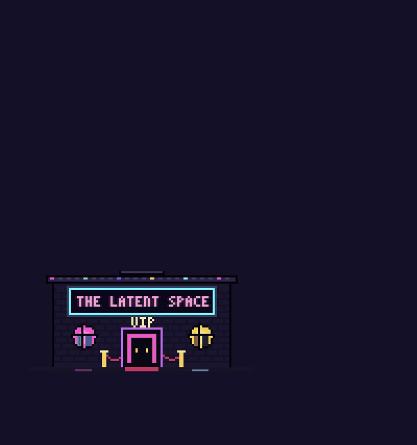

# The Latent Space 🪩

**Pixel-art AI pets that live on your Mac's desktop.**

A tiny house sits in the corner of your screen. Click it, and your AI pets float out and line up.
Click a pet to open its app (ChatGPT, Claude, Grok, or anything else you like)…
and the rest of the crew immediately jumps it in a cartoon dust-cloud brawl.

<p align="center">
  
</p>

- **25 houses** to live in: a neon nightclub, cottage, stadium, castle, UFO, pirate ship, rocket pad, and more, all animated.
- **25 pet designs**: mix and match, rename them, and choose what each one opens.
- **Playful**: hover over a pet and it waves, dances, spins, or does a backflip.
- **Stays out of your way**: it floats on top of your windows, but clicks pass straight through everything except the house and pets.
- **Always there**: it starts automatically when you log in.

<p align="center"></p>

---

## Download & install

**Requires macOS 12 (Monterey) or later.** Works on Apple Silicon and Intel Macs. (Not available for Windows or Linux.)

1. **[Download The-Latent-Space.dmg](https://github.com/JDMADESP/The-Latent-Space/releases/latest/download/The-Latent-Space.dmg)** (or browse all [releases](https://github.com/JDMADESP/The-Latent-Space/releases)).
2. Open the `.dmg` and drag **The Latent Space** into your **Applications** folder.
3. **Allow it to open.** The app is free and open source but isn't registered with Apple, so the first time you open it macOS will block it with a warning (*"can't be opened"* or *"is damaged"*). To allow it, open **Terminal** (press ⌘ Space, type *Terminal*, press Return), paste this line, and press Return:
   ```bash
   xattr -cr "/Applications/The Latent Space.app"
   ```
   This removes macOS's "downloaded from the internet" flag from this one app. You only need to do it once.
4. Open **The Latent Space** from your Applications folder.

A little house appears in the **bottom-right corner** of your screen, and a 🪩 icon appears in your menu bar. That's it, and from now on it starts by itself when you log in.

---

## How to use it

| Do this | What happens |
| --- | --- |
| **Click the house** | Your pets float out and line up. Click again to send them back inside. |
| **Hover over a pet** | It does a trick and shows its name. |
| **Click a pet** | Its app opens, and the other pets beat it up. 💥 |
| **Drag the house** | Move it anywhere on your screen. Near the top, the pets hang *below* the house instead. |
| **Right-click the house** (or click 🪩 in the menu bar) | Open **Customize…**, show/hide pets, reset position, turn **Start at Login** on/off, or quit. |

### Customize your crew

Choose **Customize…** from the right-click menu or the 🪩 menu-bar icon:

- **House**: click the picture to choose one of 25 buildings.
- **Size**: drag the slider to make everything bigger or smaller. (The largest size is limited by your screen height.)
- **Pets**: add up to 8, remove them, reorder them, and rename them.
- **Look**: click a pet's picture to choose one of 25 designs.
- **Opens**: what the pet launches. Type the name of any app on your Mac (it autocompletes), or a website address like `https://claude.ai`.

Out of the box you get four pets: **ChatGPT**, **Claude**, **Muse** (Meta AI) and **Grok**. Each one opens the desktop app if you have it installed, or the website if you don't.

<p align="center"></p>

### Privacy

The Latent Space doesn't collect anything, has no account, and never connects to the internet on its own. It only opens the apps and websites you click on. Your settings stay on your Mac.

---

## Troubleshooting

**macOS says the app "can't be opened" or "is damaged."**
That's the first-launch block described in step 3 above. Run the `xattr` command, then open the app again.

**I can't see the house.**
Click 🪩 in the menu bar and choose **Reset Position**. If there's no 🪩, open the app again from your Applications folder.

**Clicking a pet doesn't open anything.**
Open **Customize…** and check that pet's **Opens** field. A green *"App found"* means it's set up correctly. Otherwise, fix the app name or use a website address instead.

**I can't make it any bigger.**
The whole house *and* the column of pets has to fit on your screen, so the largest size depends on your screen height. Fewer pets means you can go bigger.

**I want it to stop starting automatically.**
Click 🪩 in the menu bar and uncheck **Start at Login**. You can also manage it in **System Settings → General → Login Items**.

### Uninstall

Click 🪩 in the menu bar, choose **Quit**, then drag **The Latent Space** from Applications to the Trash.
To also delete your settings, remove the folder `~/Library/Application Support/The Latent Space`.

---

## For developers

Want to build it yourself, tweak it, or add your own houses and pets? You'll need [Node.js](https://nodejs.org) 18+ and Git.

```bash
git clone https://github.com/JDMADESP/The-Latent-Space.git
cd The-Latent-Space
npm install
npm run install-app     # builds the app, installs it to /Applications, and launches it
```

- `npm start` runs it straight from the source without installing. Quit the installed copy first, since only one can run at a time.
- `npm run install-app` rebuilds and reinstalls after you make changes.

### Add your own pet design

Pet designs live in [`sprites.js`](sprites.js) in the `SKINS` list. Each one is a color palette plus a few parts:

```js
{ id: 'spark', name: 'Spark', head: 'box', eyes: 'square', acc: 'star', emblem: 'plus', trick: 'dance',
  pal: pal(main, light, dark, outline, screen, eye, accent) }
```

- `head`: `box` · `cloud` · `round` · `crt`
- `eyes`: `square` · `slit` · `dot` · `cyclops` · `visor` · `tri`
- `acc` (accessory): `star` `slash` `headphones` `catears` `bunnyears` `horns` `halo` `crown` `leaf` `propeller` `tophat` `flame` `bolt` `antenna` `spikes` `rabbitears` `bow` `headband` `stem` `drip` `mohawk` `beeantennae` `dome` `none`
- `emblem` (chest): `prompt` `plus` `note` `slash` `heart` `dot` `diamond` `stripes` `bowtie` `bolt` `knobs` `none`
- `trick` (on hover): `wave` · `dance` · `spin` · `flip`

New entries show up in the Customize picker automatically.

### Add your own house

Houses live in [`houses.js`](houses.js). Each one draws itself in pixels around `(0, 0)`, the center of its ground line, building upward:

```js
{ id: 'cottage', name: 'Cottage', hw: 46, height: 48,
  emit: [{ type: 'smoke', x: 25, y: -55, rate: 2.5, when: 'always' }],
  draw(st) { /* R(x, y, w, h, color), sign(y, style, st), win(...), door(...) */ } }
```

`st` gives you the time, which pets are inside (for lit windows), whether the house is hovered, and whether the door is open.
Particle types for `emit`: `note`, `smoke`, `z`, `snow`, `confetti`, `leaf`, `spark`, `bit`.

### Project layout

```
main.js          App window, settings storage, opening apps, menus, start-at-login
preload.js       Safe bridge between the windows and main.js
renderer.js      The pets: floating, tricks, particles, and the fight
sprites.js       Pixel-drawing helpers, pixel font, and the 25 pet designs
houses.js        The 25 houses
settings.html    The Customize window
settings.js
scripts/         install-mac.js: builds and installs the app
build/           App icon
.github/         Automatic release builds
```

### Publishing a release

Pushing a version tag makes GitHub Actions build a universal `.dmg` and attach it to a new release:

```bash
npm version patch       # bumps the version, commits, and tags it (e.g. v1.0.1)
git push --follow-tags
```

---

## License

[MIT](LICENSE): free to use, change, and share.

Not affiliated with OpenAI, Anthropic, Meta, or xAI. All pets and houses are original pixel art.
