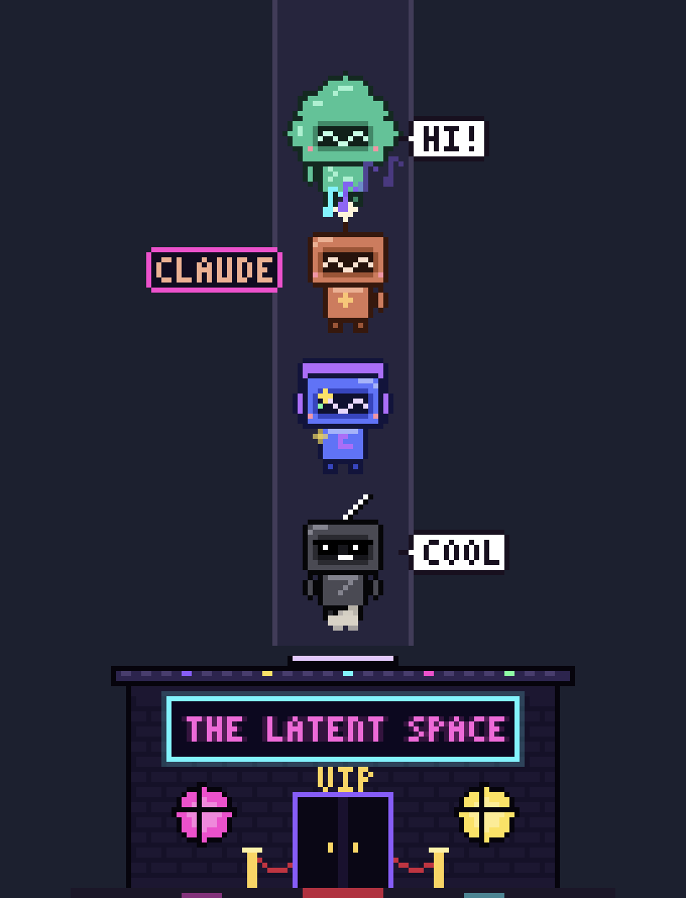
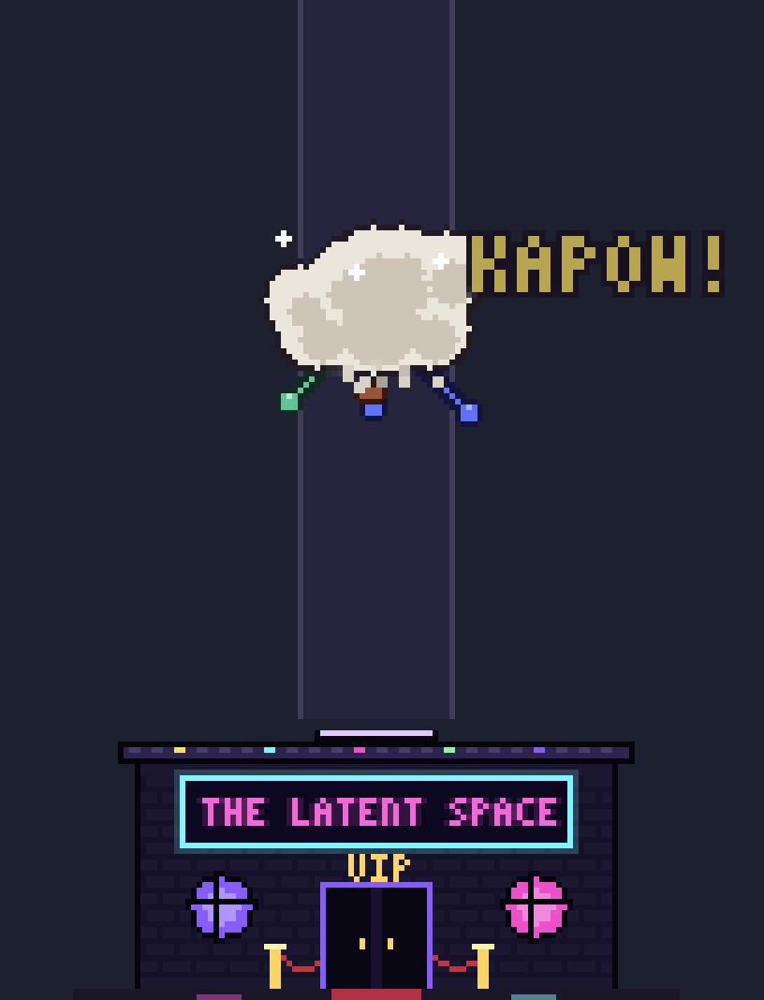
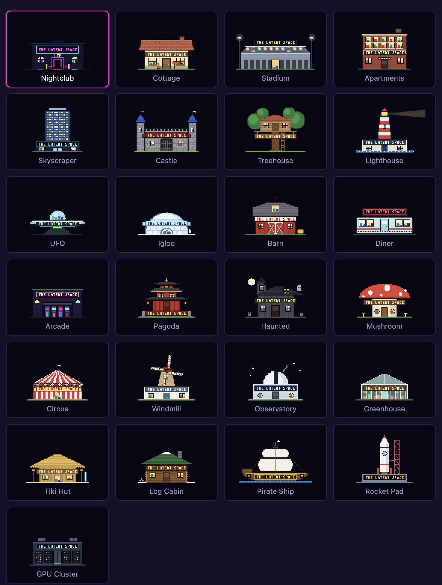
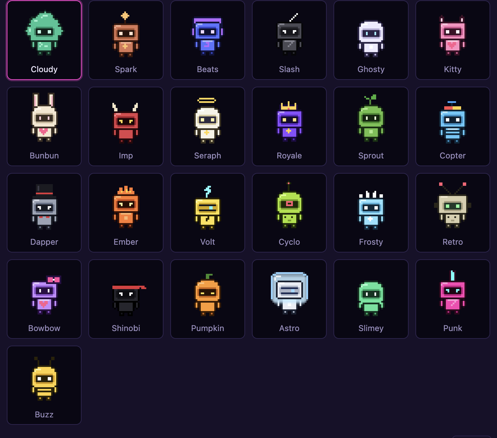

# The Latent Space 🪩

A tiny pixel-art **house that lives on your desktop**, full of AI pets — pick from 25 buildings,
from a neon nightclub to a stadium, castle, UFO, or pirate ship.
Click it and your pets float up out of the roof in a glowing column.
Each pet launches one of your AI apps — and when you click one, the app opens
**and the rest of the crew immediately jumps it** in a cartoon dust-cloud brawl.

<p align="center">
  
  &nbsp;&nbsp;
  
</p>

## Features

- **25 houses** — Nightclub, Cottage, Stadium, Apartments, Skyscraper, Castle, Treehouse, Lighthouse, UFO, Igloo, Barn, Diner, Arcade, Pagoda, Haunted House, Mushroom, Circus, Windmill, Observatory, Greenhouse, Tiki Hut, Log Cabin, Pirate Ship, Rocket Pad and GPU Cluster. Each one is animated (chimney smoke, falling snow, spinning windmill blades, a crowd doing the wave…) and carries a **THE LATENT SPACE** sign.
- **Floating pets** — click the club and they rise out of the roof into a stacked, bobbing column.
- **Hover tricks** — every pet has a move: wave, dance (with music notes), spin (with sparkles), or a backflip into sunglasses.
- **Click to launch + brawl** — the app opens instantly; the other pets charge in, a dust cloud full of fists and `POW!` `BONK!` erupts, and the victim floats there KO'd with stars over its head.
- **25 pet skins**, any app or URL per pet, up to 8 pets, and a smooth size slider — all from the **Customize** window.
- Stays on top of your windows, but clicks pass straight through everything that isn't the club or a pet.

<p align="center"></p>
<p align="center"></p>

## Install

Requires **macOS**. Once installed, The Latent Space runs in the background and **starts by itself every time you log in** — no terminal needed.

### Option A — Download the app

1. Grab the latest **`.dmg`** from the [Releases page](https://github.com/JDMADESP/The-Latent-Space/releases/latest).
2. Open it and drag **The Latent Space** into **Applications**.
3. The app isn't notarized by Apple (that costs $99/yr), so macOS will block the first launch. Run this once in Terminal, then open the app normally:
   ```bash
   xattr -cr "/Applications/The Latent Space.app"
   ```

### Option B — Build it yourself (one command)

Requires [Node.js](https://nodejs.org) 18+.

```bash
git clone https://github.com/JDMADESP/The-Latent-Space.git
cd The-Latent-Space
npm install
npm run install-app
```

This builds the app for your Mac, installs it to `/Applications`, launches it, and turns on start-at-login.
Run `npm run install-app` again any time you pull updates.

### Start at login

It's on by default. Toggle it from the 🪩 menu-bar icon → **Start at Login**, or in
**System Settings → General → Login Items**. To stop it for now, choose **Quit** from the same menu.

### Uninstall

Quit it from the 🪩 menu, then delete `/Applications/The Latent Space.app`
(and optionally `~/Library/Application Support/The Latent Space` for your settings).

### Developing

`npm start` runs it straight from the source without installing — handy while editing.

### Publishing a release (maintainers)

Push a version tag and GitHub Actions builds a universal (Apple Silicon + Intel) `.dmg` and attaches it to a Release:

```bash
npm version patch          # bumps package.json, commits, and tags (e.g. v1.0.1)
git push --follow-tags
```

## Using it

| Do this | To |
| --- | --- |
| Click the house | Bring the pets out / send them back inside |
| Hover a pet | Make it do its trick and show its name |
| Click a pet | Open its app (then watch the fight) |
| Drag the house | Move it anywhere (position is remembered) |
| Right-click the house, or click 🪩 in the menu bar | Show/hide pets, **Customize…**, reset position, quit |

## Customizing

Open **Customize…** from the right-click or menu-bar menu:

- **House** — click the picture to pick from 25 buildings.
- **Size** — drag the slider; everything scales live. The maximum is the biggest size that fits your screen height (more pets = taller column = smaller max).
- **Pets** — add up to 8, reorder them (top of the list = top of the column), rename them.
- **Look** — click a pet's picture to pick from 25 skins.
- **Opens** — type an app name exactly as it appears in `/Applications` (it autocompletes), or a URL like `https://claude.ai`.

On first launch, the default crew (ChatGPT, Claude, Muse, Grok) opens the desktop app if you have it installed, and the website if you don't.

Settings are saved to `~/Library/Application Support/The Latent Space/config.json`.

## Making your own houses

Houses live in [`houses.js`](houses.js). Each one draws itself around `(0, 0)` = centre of the ground line, building upward:

```js
{ id: 'cottage', name: 'Cottage', hw: 46, height: 48,
  emit: [{ type: 'smoke', x: 25, y: -55, rate: 2.5, when: 'always' }],
  draw(st) { /* R(x, y, w, h, color), sign(y, style, st), win(...), door(...) */ } }
```

`st` tells you the time, which pets are inside (for lit windows), whether it's hovered, and whether the door is open. Particle types for `emit`: `note`, `smoke`, `z`, `snow`, `confetti`, `leaf`, `spark`, `bit`.

## Making your own skins

Skins live in [`sprites.js`](sprites.js) in the `SKINS` array. Each one is a palette plus a few parts:

```js
{ id: 'spark', name: 'Spark', head: 'box', eyes: 'square', acc: 'star', emblem: 'plus', trick: 'dance',
  pal: pal(main, light, dark, outline, screen, eye, accent) }
```

- `head`: `box` · `cloud` · `round` · `crt`
- `eyes`: `square` · `slit` · `dot` · `cyclops` · `visor` · `tri`
- `acc`: `star` `slash` `headphones` `catears` `bunnyears` `horns` `halo` `crown` `leaf` `propeller` `tophat` `flame` `bolt` `antenna` `spikes` `rabbitears` `bow` `headband` `stem` `drip` `mohawk` `beeantennae` `dome` `none`
- `emblem`: `prompt` `plus` `note` `slash` `heart` `dot` `diamond` `stripes` `bowtie` `bolt` `knobs` `none`
- `trick`: `wave` · `dance` · `spin` · `flip`

Add an entry and it shows up in the picker automatically.

## Project layout

```
main.js        Electron main process: transparent window, config, app launching, menus, start-at-login
preload.js     Safe bridge between the windows and the main process
renderer.js    The floating column, tricks, particles, and the fight
sprites.js     Pixel helpers, pixel font, and all 25 pet skins (shared by both windows)
houses.js      All 25 houses (shared by both windows)
settings.html  Customize window
settings.js
```

## License

[MIT](LICENSE). Not affiliated with OpenAI, Anthropic, Meta, or xAI. The pets are original pixel art.
